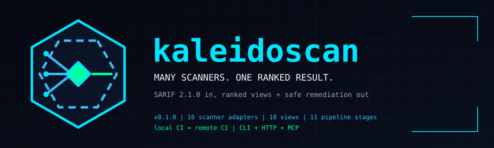
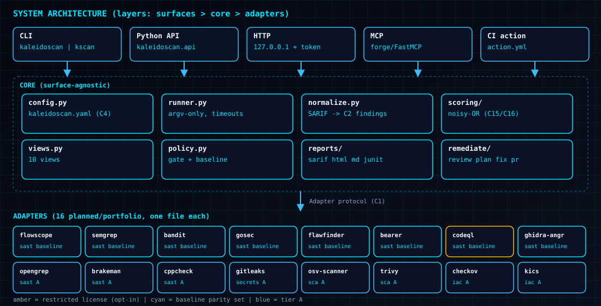
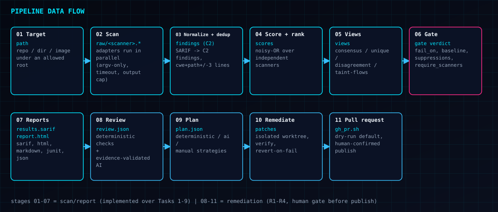
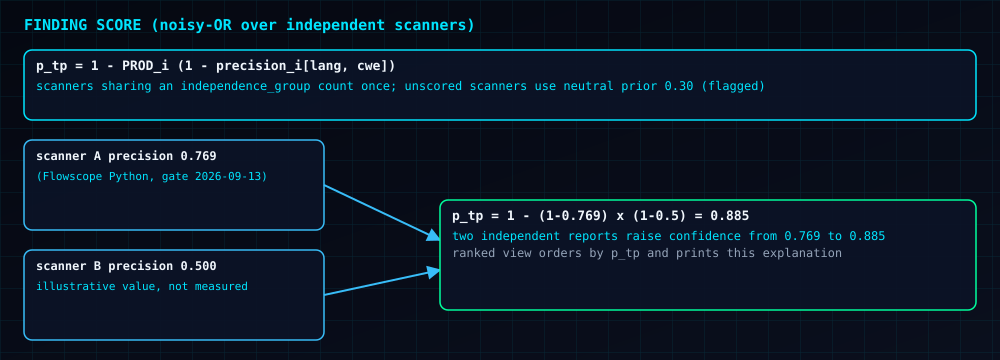
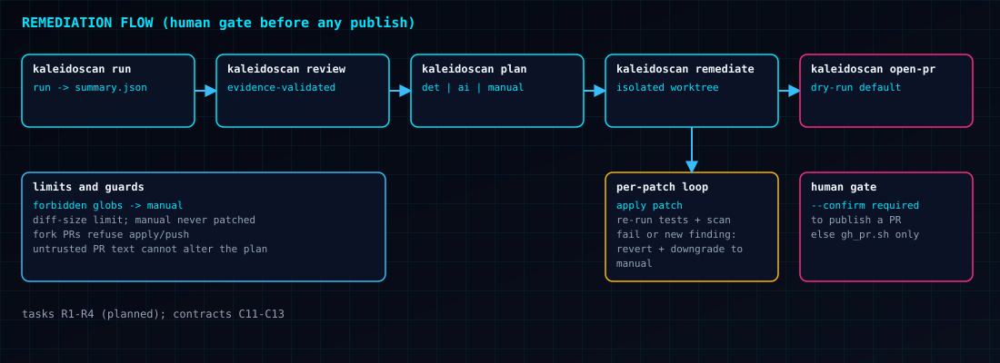
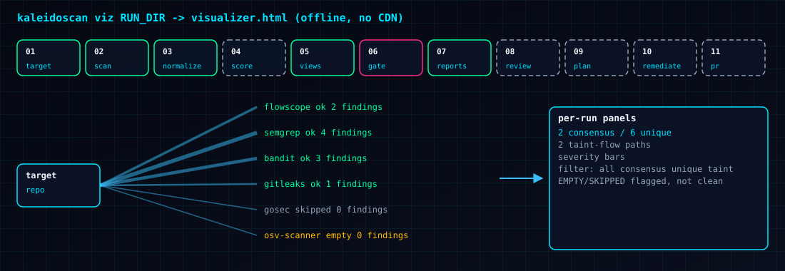

<p align="center"></p>

  

**kaleidoscan** runs several security scanners over one target, normalizes every result to SARIF 2.1.0 plus a small
run envelope, ranks findings by *measured* scanner reliability (not by counting tools), and gates the result in local or
remote CI. The same capabilities are meant to be exposed through a CLI, a Python API, an HTTP facade, an MCP server and
a CI action. Dynamic testing (DAST) is a reserved placeholder only.

> **Status (honest):** this is early development. Implemented today: `kaleidoscan doctor` (tool availability) and
> `kaleidoscan viz` (offline pipeline visualizer). Everything else in the docs is the **planned** design from the spec and is
> labelled "planned" wherever a command or adapter is described. See [docs/running.md](docs/running.md) for the exact status table.

The project is generated and checked so that documented counts cannot drift: 16 scanner adapters in the portfolio
(all planned), 10 views and 11 pipeline stages, derived from `kaleidoscan/catalog.py` (see [docs/scanners.md](docs/scanners.md)).

## Visual showcase

| | |
|---|---|
|  |  |
| Architecture: surfaces, core, adapters | Data flow through 11 pipeline stages |
|  |  |
| Ranking: noisy-OR over independent scanners | Remediation with a verify-and-revert loop and human gate |



More graphics: scanner portfolio, views, MCP forge pipeline, CI topology and trust boundaries are embedded in
[docs/architecture.md](docs/architecture.md) and [docs/integrations.md](docs/integrations.md). Benchmark charts and real
report screenshots are placeholders until Task 13 (benchmark) and Task 9 (reporters) land.

## Quickstart

```bash
uv tool install .                 # or: uv sync && uv run kaleidoscan ...
kaleidoscan doctor                # which scanners are installed, and their versions
kaleidoscan viz --sample --out visualizer.html   # offline pipeline visualizer on the bundled sample run
```

Open the sample visualizer: [docs/examples/visualizer.html](docs/examples/visualizer.html) (self-contained, no network).
The `kscan` alias is installed alongside `kaleidoscan`.

## Documentation

Start at the [docs hub](docs/README.md) or the [user manual](docs/usermanual/README.md).
[Purpose](docs/purpose.md) · [Architecture](docs/architecture.md) · [Running and CLI reference](docs/running.md) ·
[Configuration](docs/configuration.md) · [How-to](docs/how-to.md) · [Scanners](docs/scanners.md) ·
[Views and scoring](docs/views-and-scoring.md) · [Remediation](docs/remediation.md) · [HTTP, MCP and CI](docs/integrations.md) ·
[Visualizer](docs/visualizer.md) · [Contributing](docs/CONTRIBUTING.md) · [Changelog](docs/CHANGELOG.md).
The GitHub Pages site lives in [docs/index.html](docs/index.html) (not yet published).

## Verify

```bash
scripts/verify.sh              # smoke, unit, integration, system, security tiers; prints PASS/SKIP/FAIL per tier
scripts/verify.sh --tier unit
python3 scripts/render-graphics.py   # regenerate graphics, docs/scanners.md, docs/data.json and the Pages shell
```

Build output, virtualenvs and caches default to `/datanapps` (see `scripts/verify.sh`) and never to `/tmp`.

## License

MIT, see [LICENSE](LICENSE).
