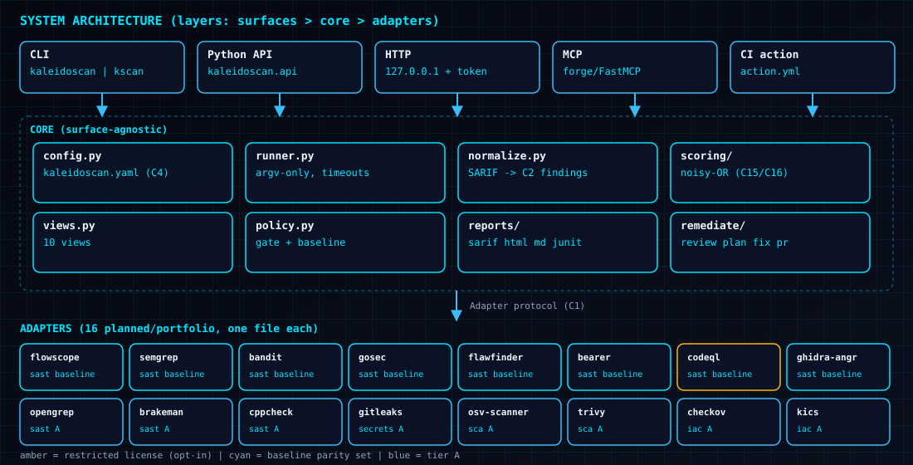

# Documentation hub

Recommended reading order:

1. [Purpose](purpose.md): the problem, tenets, threat model.
2. [Architecture](architecture.md): layers, adapters, data flow, trust boundaries.
3. [Running](running.md): install, CLI reference, exit codes, environment variables.
4. [Configuration](configuration.md): the `kaleidoscan.yaml` reference.
5. [How-to](how-to.md): recipes.
6. [Scanners](scanners.md) and [Views and scoring](views-and-scoring.md).
7. [Remediation](remediation.md) and [HTTP, MCP and CI](integrations.md).
8. [Visualizer](visualizer.md): the offline pipeline/run visualizer ([sample](examples/visualizer.html)).
9. [User manual](usermanual/README.md), [Contributing](CONTRIBUTING.md), [Changelog](CHANGELOG.md).

Site: [index.html](index.html) is the GitHub Pages landing page. Status labels used everywhere: **implemented** (code and
tests exist) and **planned** (specified, not built).

