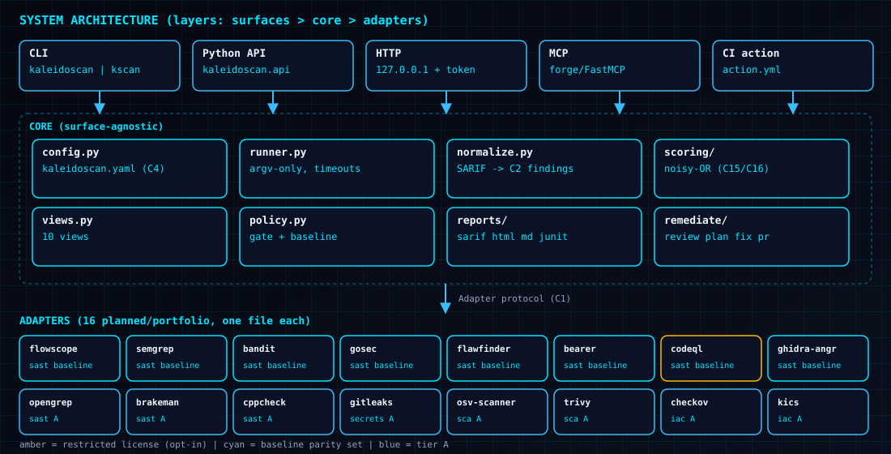
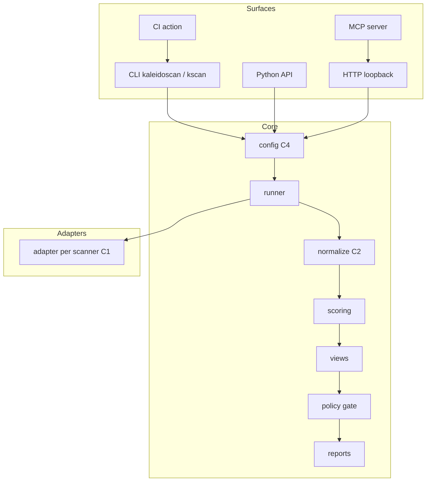
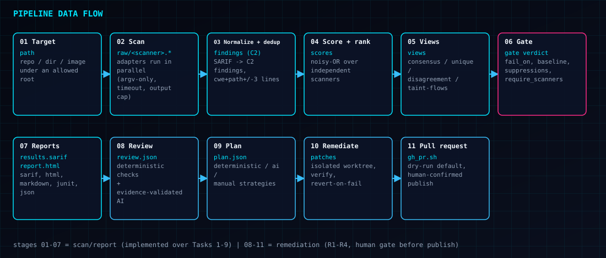
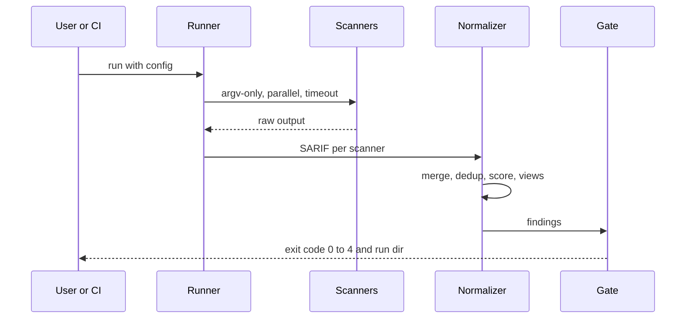
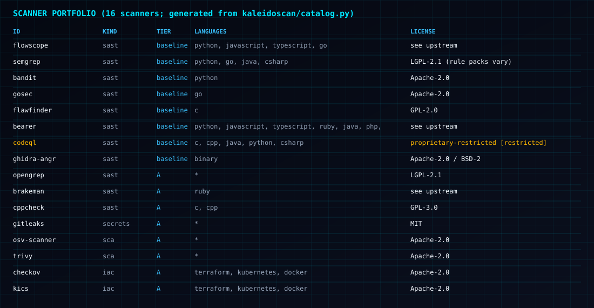
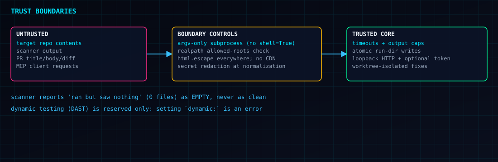
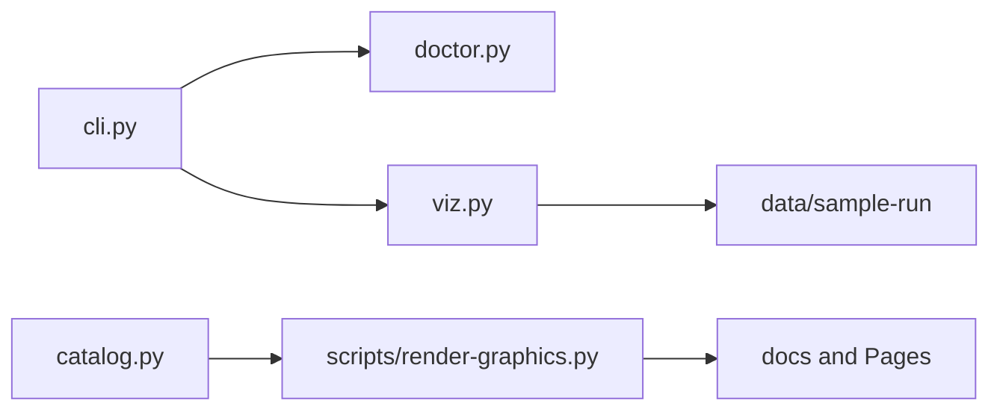

# Architecture

Layers (status: **planned** except the CLI shell, `doctor` and `viz`):

## Adapter model (C1)

Every scanner is one file implementing `Adapter` (`detect`, `applicable`, `run`) plus a registry line and a fixture-based
test; the core never changes. A run returns a `ScannerResult` with status `ok | empty | skipped | error | timeout`.
Registry: entry-point group `kaleidoscan.adapters`.

## Data flow

A run directory holds `summary.json` (envelope C3), merged canonical `results.sarif`, `raw/`, and the reports.
Writes are atomic (temp dir, then rename). Only `summary.json` carries timestamps, so the SARIF and HTML are byte-reproducible.

## Scanner portfolio

Full generated table: [scanners.md](scanners.md).

## Scoring, selection and views

See [views-and-scoring.md](views-and-scoring.md). Remediation: [remediation.md](remediation.md). Surfaces: [integrations.md](integrations.md).

## Trust boundaries

Untrusted: target contents, scanner output, PR text, MCP requests. Controls sit at the boundary; the core assumes validated data.

## What exists in code today

`catalog.py` is the single source for documented counts; `tests/test_docs.py` fails when docs drift from it.
