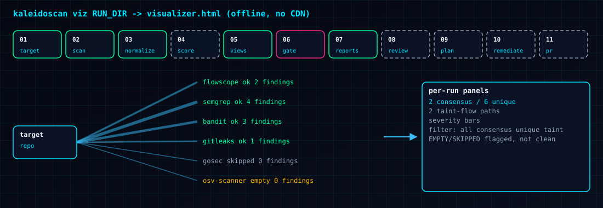

# How-to

Recipes. Commands marked (planned) are not implemented yet; the others are exercised by the doc tests.


## Check which scanners are installed

```bash
kaleidoscan doctor
kaleidoscan doctor --json     # machine-readable, stdout is only JSON
kaleidoscan doctor --strict   # exit 3 when flowscope is missing
```

## Visualize a run

```bash
kaleidoscan viz --sample --out visualizer.html
kaleidoscan viz runs/<run_id>
```



## Scan a repo (planned)

```bash
kaleidoscan run --target . --out runs/
kaleidoscan gate runs/<run_id>
```

## Scan a PR, reading only new findings (planned)

```bash
kaleidoscan run --profile ci
kaleidoscan diff runs/<base> runs/<head>
```

## Pick scanners (planned)

```bash
kaleidoscan select --explain
```

## Remediate and open a PR (planned)

```bash
kaleidoscan fix
kaleidoscan open-pr
```

See [remediation.md](remediation.md).

## Add a scanner adapter

Create one file under `kaleidoscan/adapters/`, implement the C1 protocol, add a registry line, add a fixture-based golden test,
and add the scanner to `kaleidoscan/catalog.py`; then run `python3 scripts/render-graphics.py` so docs update. See [CONTRIBUTING.md](CONTRIBUTING.md).

## Use the MCP server (planned)

See [integrations.md](integrations.md).
