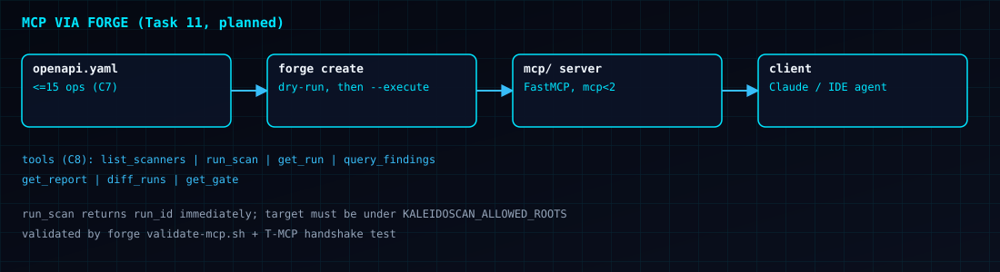
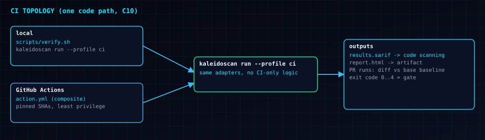

# HTTP, MCP and CI surfaces

Status: all **planned** (Tasks 10, 11, 14). Every capability must exist on every surface; a parity test will enforce it.

| Capability | CLI | HTTP | MCP tool |
|---|---|---|---|
| list scanners | `kaleidoscan scanners` | `GET /scanners` | `list_scanners` |
| run pipeline | `kaleidoscan run` | `POST /runs` (202, async) | `run_scan` |
| run status/results | `kaleidoscan show` | `GET /runs/{id}` | `get_run` |
| query findings | `kaleidoscan findings` | `GET /runs/{id}/findings` | `query_findings` |
| render report | `kaleidoscan report` | `GET /runs/{id}/report` | `get_report` |
| compare runs | `kaleidoscan diff` | `GET /diff` | `diff_runs` |
| gate verdict | `kaleidoscan gate` | `GET /runs/{id}/gate` | `get_gate` |

## HTTP

Loopback bind only (127.0.0.1), optional bearer token from `KALEIDOSCAN_TOKEN`, at most 15 operations.

## MCP

Generated from `openapi.yaml` with MCP Forge (dry-run first, human gate before accepting output). `run_scan` returns a run id
immediately; targets must be under `KALEIDOSCAN_ALLOWED_ROOTS`.

## CI

Local: `scripts/verify.sh` and `kaleidoscan run --profile ci`. Remote: a composite action with inputs `config`, `profile`,
`fail_on`, `upload_sarif`, outputs `run_id`, `gate`; uploads `results.sarif` to code scanning and `report.html` as an artifact;
pull requests use `diff` against the base baseline. Workflows pin action SHAs, use least-privilege `permissions`, and never expose
secrets to fork pull requests. The docs site deploys with `.github/workflows/pages.yml` (not enabled).
