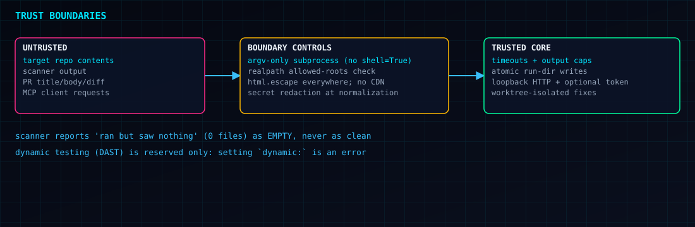

# Purpose

## Problem

No single scanner covers a realistic code base. On a Python corpus used for internal benchmarking, Flowscope measured
60% recall and 76.9% precision (gate-measured 2026-09-13), while Bandit reached 20% recall, Semgrep 8% and CodeQL 0/50
(it lacked entrypoint models). Scanners overlap and disagree, so running several needs normalization and de-duplication.
Scanners can also run and see nothing (for example gosec returned zero results until the directory/build model was right),
which must be reported rather than shown as "clean". There is currently no single entry point that runs N scanners,
merges, ranks and reports. No measured time or cost pain figure exists; none is claimed here.

## Tenets

- **Multi-view.** Maximize independent views of the same target; let evidence decide which to trust.
- **Measured trust.** Scanner reliability scores come from a benchmark corpus, not vendor claims. Unscored scanners get a
  neutral prior and are labelled `unscored`.
- **Safe by default.** argv-only subprocesses, allowed roots, escaped reports, redacted secrets, loopback services,
  human gates before anything outward-facing.
- **One path.** The local runner and CI run the same code.

## Threat model

| Risk | Mitigation |
|---|---|
| Malicious repo content attacks scanners or reports | escape every string; no code execution; argv-only subprocess; realpath allowed-roots check |
| Scanner hangs or emits huge output | timeouts, process-group kill, output cap, per-scanner isolation |
| False "clean" from zero files analyzed | `files_analyzed` + `EMPTY` status; gate can require non-empty |
| Secrets leak through reports or MCP | redact at normalization |
| Dedup heuristic over/under-merges | tunable constant, tested at the boundary, raw per-scanner SARIF kept |
| Dynamic testing misuse | out of scope; reserved only |

Status: the controls above are the design; today only the visualizer's escaping and the no-`shell=True` lint are implemented and tested.
