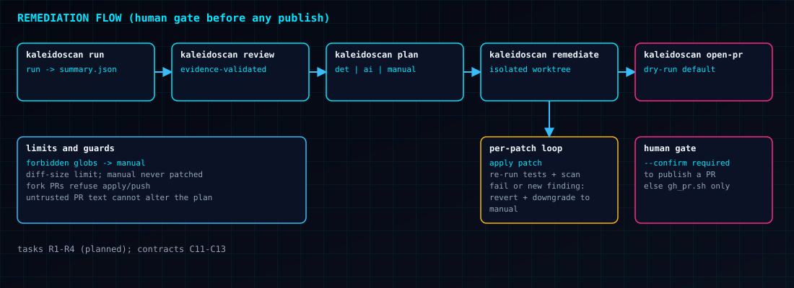
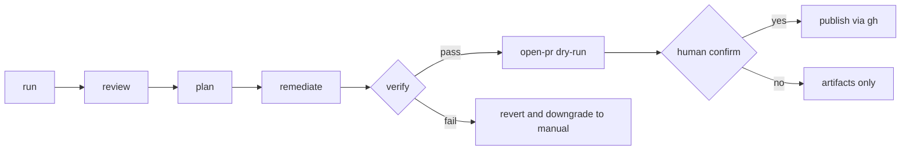

# Remediation flow

Status: **planned** (tasks R1-R4; contracts C11-C13).

- **review**: deterministic checks (ranked/consensus/unique views, diff-only new findings) plus an optional AI reviewer behind a
  validator that requires evidence lines; unknown means `needs-human`.
- **plan**: each finding maps to a strategy `deterministic | ai | manual`; manual items are never patched; forbidden globs and
  diff-size limits force manual.
- **remediate**: isolated git worktree (original tree untouched); each patch is verified (tests plus re-scan); a failing patch or
  one that introduces a new finding is reverted and downgraded.
- **open-pr**: dry-run by default (artifacts and a `gh_pr.sh`); publishing needs explicit confirmation; fork PRs refuse apply and push.
- PR title, body and diff are untrusted input and must never change the plan.
