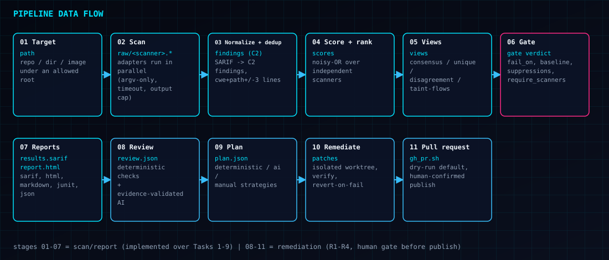

# User manual

A guided path. Each chapter links to the reference that owns the detail.

1. **Getting started**: install and run `kaleidoscan doctor` ([running.md](../running.md)).
2. **Concepts**: scanners, findings, envelope, views, scores ([views-and-scoring.md](../views-and-scoring.md)).
3. **Pipelines**: `kaleidoscan.yaml` ([configuration.md](../configuration.md)).
4. **Reports and the visualizer**: [visualizer.md](../visualizer.md), [sample](../examples/visualizer.html).
5. **Remediation**: [remediation.md](../remediation.md).
6. **Integrations**: HTTP, MCP, CI ([integrations.md](../integrations.md)).
7. **Troubleshooting**: `doctor` shows what is missing; exit 3 means a required scanner is missing or failed; an `EMPTY` scanner
   analyzed zero files and its silence is not a clean bill of health.

