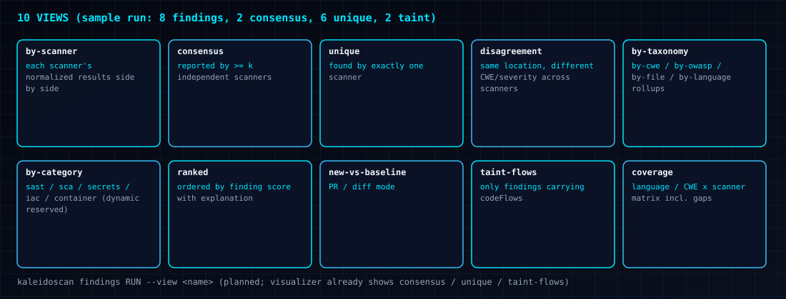
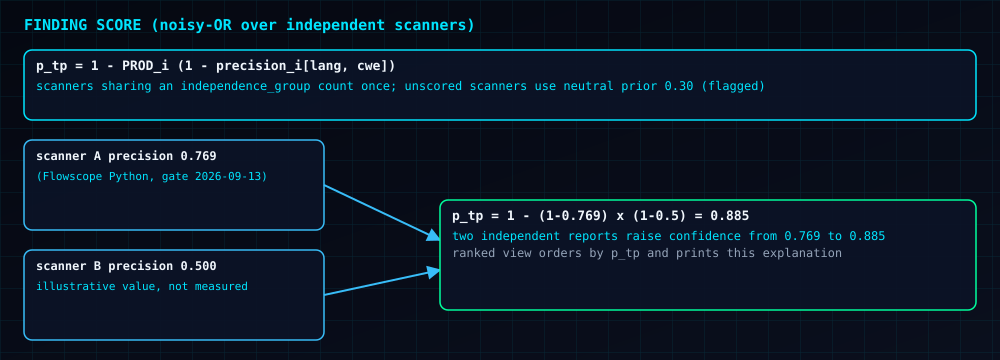
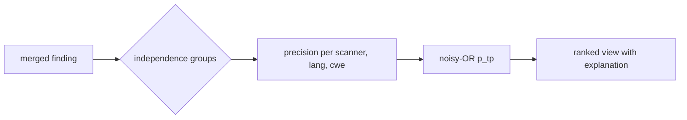

# Views and scoring

Status: views are **planned** (Task 8b) except that the [visualizer](visualizer.md) already shows consensus, unique and taint-flow
slices of a run envelope. Scoring is **planned** (Task 8a).



There are 10 views:

| view | meaning |
|---|---|
| `by-scanner` | each scanner's normalized results side by side |
| `consensus` | reported by >= k independent scanners |
| `unique` | found by exactly one scanner (marginal value, also likely false positives) |
| `disagreement` | same location, different CWE/severity across scanners |
| `by-taxonomy` | by-cwe / by-owasp / by-file / by-language rollups |
| `by-category` | sast / sca / secrets / iac / container (dynamic reserved) |
| `ranked` | ordered by finding score with the explanation |
| `new-vs-baseline` | PR / diff mode |
| `taint-flows` | only findings carrying SARIF `codeFlows` |
| `coverage` | language / CWE x scanner matrix incl. gaps and EMPTY/SKIPPED |

## Scores

Two separate scores. (a) **Scanner reliability** per (scanner, language, CWE-class): precision, recall, F1, sample size and a
Wilson 95% interval, computed offline from a gold corpus; low-n cells shrink toward the scanner's global value; unscored
scanners use a neutral prior of 0.30 and are flagged. (b) **Finding score** per merged finding:



```text
p_tp = 1 - PROD_i (1 - precision_i[lang, cwe])     over independent scanners that reported it
```

The worked example in the graphic uses one measured precision (0.769) and one **illustrative** value; no benchmark numbers
for the pipeline exist yet (Task 13).



## Selection

`select` picks complementary scanners by greedy marginal gain under a license policy and time budget, with `--explain`.
Until real scores exist a fixture score file labelled `fixture` is used.
