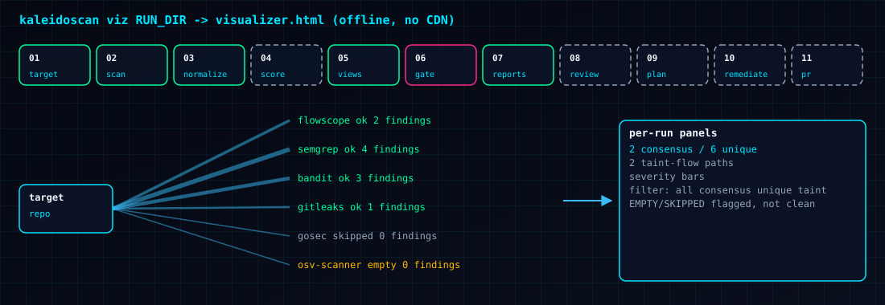

# Visualizer

Status: **implemented**. `kaleidoscan viz` turns a run envelope into one self-contained, offline HTML file: no CDN, no external
fonts, no network. Output is deterministic: the same envelope produces byte-identical HTML.

```bash
kaleidoscan viz --sample --out visualizer.html     # bundled synthetic sample run
kaleidoscan viz path/to/run-dir                    # writes path/to/run-dir/visualizer.html
```

Input: `summary.json` (schema `kaleidoscan.run/1`, required) and optionally `results.sarif`; SARIF `codeFlows` fill in
taint-flow paths for findings whose envelope entry has no `code_flow`. Exit code 2 for a missing directory, bad JSON or wrong schema.



Panels:

1. **Pipeline stages**: all 11 stages (target, scan, normalize, score, views, gate, reports, review, plan, remediate, pr). A stage is
   shown as done/failed only when the envelope proves it; stages not yet implemented are shown dashed as pending.
2. **Scanner fan-out**: one node per scanner with status and finding count; edge width is the count. `EMPTY` and `SKIPPED` scanners
   are highlighted as "saw nothing", never as clean.
3. **Summary and severity bars**, consensus vs unique counts.
4. **Findings table** with filters (all, consensus, unique, taint-flows) and expandable taint-flow paths.

Try the [sample run](examples/visualizer.html) (synthetic data, clearly marked, not a real scan). All strings are HTML-escaped and
the embedded data blob cannot close its script tag; tests cover both, plus offline-ness and determinism.
